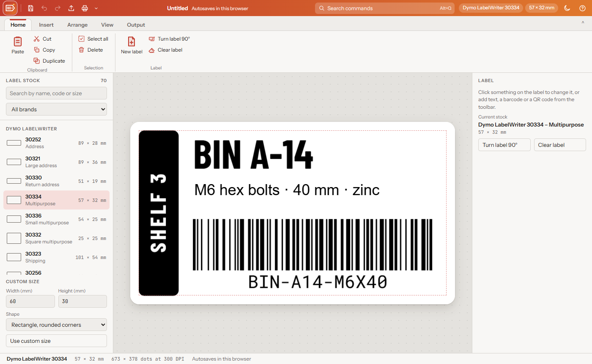

# LabelCraft

**A label maker that runs in your browser: Dymo, Brother, Zebra and Avery labels with barcodes and QR codes.**

Pick your label stock, add text, barcodes, QR codes, shapes and logos, rotate them any way you need, then print at real size or export a sharp image. Everything works offline from this folder.



## Getting started

1. Download this repository (green **Code** button › **Download ZIP**) or clone it.
2. Double-click `index.html`. It opens in Chrome or Edge.
3. Pick your **label stock** on the left (search by name, code or size), or type a **custom size**.
4. Add text, a barcode or a QR code from the toolbar, then **File › Print** or **Export**.

Your label also autosaves in the browser.

## Finding your way

| Where | What is there |
| --- | --- |
| **LabelCraft logo** (top left) | Every command in classic menus: File, Edit, Insert, View, Help (also F10) |
| **Top bar** | Quick buttons (save, undo, redo, export, print; customize them with ⌄), the label name, **Search commands (Alt+Q)**, label stock and size, theme, help |
| **Ribbon tabs** | **Home** (clipboard, label), **Insert** (text, barcode, QR code, shapes, image), **Arrange** (rotate, order), **View** (zoom, guides, units, theme), **Output** (export, print, save) |

## What it does

### Label stock (70 sizes built in)
- **Dymo LabelWriter** (30252 address, 30334 multipurpose, 30256 shipping…)
- **Dymo D1** tape
- **Brother DK** rolls and **Brother TZe** tape
- **Zebra / thermal** labels
- **Avery** sheets (US Letter and A4)
- **Custom size** in mm or inches: rounded or square corners, round / oval, or continuous tape (set the tape length).
- **Turn label 90°** turns the whole label sideways, content and all.

### Design
- **Text**: any font (system fonts plus bundled Barlow Condensed, Oswald, Roboto Mono, Archivo Black), size in points, bold, italic, underline, left / centre / right.
- **Shapes**: box, ellipse, line. **Images and logos** from your computer.
- **Rotate** anything **90° left, 90° right or 180°**, or type any angle.
- **Align** to the label edges and centre; **snap to centre**; bring to front / send to back.
- **Safe print area** guide, zoom, fit to window, actual size (100%).
- Undo / redo, cut / copy / paste / duplicate, select all, nudge with the arrow keys.

### Barcodes and QR codes
Barcodes are drawn as exact vector bars at the size you set, so they never get blurry or stretched.

| Type | Use |
| --- | --- |
| Code 128 | Letters and numbers (most common) |
| Code 39 | Capitals, numbers, `- . $ / + %` |
| EAN-13 / EAN-8 | Retail products |
| UPC-A | US retail |
| ITF-14 / Interleaved 2 of 5 | Shipping cartons |
| Codabar | Libraries, blood banks |
| MSI | Shelf labels |
| Pharmacode | Pharmaceutical packaging |
| QR code | Links, text, Wi-Fi details… (full Unicode) |

### Save, print and export
- **Save / Open** label files (`.json`), so you can reuse and edit labels later.
- **Print** at the label's real size.
- **Export** as **PNG**, **JPG** or **SVG** at **203, 300 or 600 DPI** (203 and 300 match most label printers).
- Light and dark mode for the editor (labels always print black on white).

## Keyboard shortcuts

| Action | Keys |
| --- | --- |
| Open a label | Ctrl+O |
| Save / Save as | Ctrl+S / Ctrl+Shift+S |
| Export image | Ctrl+E |
| Print | Ctrl+P |
| Undo / Redo | Ctrl+Z / Ctrl+Y |
| Cut / Copy / Paste | Ctrl+X / Ctrl+C / Ctrl+V |
| Duplicate | Ctrl+D |
| Select all | Ctrl+A |
| Delete selection | Delete |
| Rotate 90° right / left | R / Shift+R |
| Nudge 0.5 mm / 5 mm | Arrows / Shift+Arrows |
| Zoom in / out / fit | + / − / 0 |

## For developers

The app is written in `labelcraft.src.html`. After changing it, run:

```
python build.py
```

This writes:
- `index.html`: the offline app, using `lib/` (libraries) and `fonts/` from this folder
- `dist/artifact.html`: a single-file version that loads the libraries and fonts online

`python fetch_fonts.py` downloads the fonts into `fonts/` again if they are ever missing.

## Requirements

Chrome or Edge (recent versions). Firefox and Safari work too, but download files instead of saving straight into a folder.

## Credits

- [Fabric.js](http://fabricjs.com/) 5.3.1, [JsBarcode](https://github.com/lindell/JsBarcode) 3.11.6, [qrcode-generator](https://github.com/kazuhikoarase/qrcode-generator) 1.4.4 (all MIT)
- Fonts: Archivo Black, Barlow Condensed, Instrument Sans, JetBrains Mono, Oswald, Roboto Mono (SIL Open Font License)

## Development notes

How the app is built, the decisions behind it, and known pitfalls: see [NOTES.md](NOTES.md).
