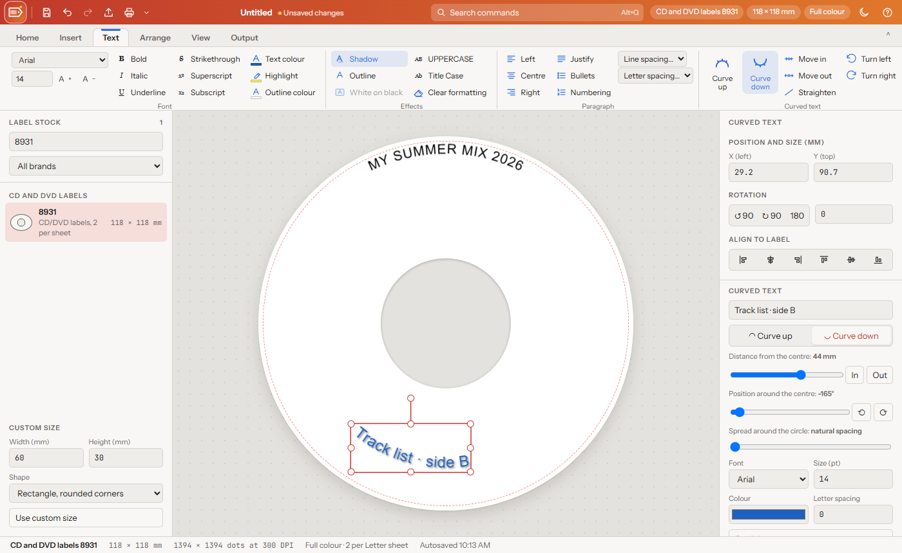

# LabelCraft

**A label maker that runs in your browser: Dymo, Brother, Zebra and Avery labels with barcodes and QR codes.**

Pick your label stock, add text, barcodes, QR codes, shapes and logos, rotate them any way you need, then print at real size or export a sharp image. Everything works offline from this folder.


## Getting started

1. Download this repository (green **Code** button › **Download ZIP**) or clone it.
2. Double-click `index.html`. It opens in Chrome or Edge.
3. Pick your **label stock** on the left (search by name, code or size), or type a **custom size**.
4. Add text, a barcode or a QR code from the toolbar, then **File › Print** or **Export**.

Your label also autosaves in the browser.

## Finding your way

| Where | What is there |
| --- | --- |
| **LabelCraft logo** (top left) | Every command in classic menus: File, Edit, Insert, View, Help (also F10) |
| **Top bar** | Quick buttons (save, undo, redo, export, print; customize them with ⌄), the label name, **Search commands (Alt+Q)**, label stock and size, theme, help |
| **Ribbon tabs** | **Home** (clipboard, label), **Insert** (text, barcode, QR code, shapes, image), **Arrange** (rotate, order), **View** (zoom, guides, units, theme), **Output** (export, print, save) |

## What it does

### Label stock (100+ sizes built in)
- **Dymo LabelWriter** (30252 address, 30334 multipurpose, 30256 shipping…)
- **Dymo D1** tape
- **Brother DK** rolls and **Brother TZe** tape
- **Zebra / thermal** labels
- **Avery** sheets for laser and inkjet printers, with their real sheet layouts: 22 US Letter templates (5160, 5161, 5162, 5163, 5164, 5167, 5195, 5366, 5395, 5371, round and square labels…) and 20 A4 templates (L7160/J8160, L7163, L7165, L7651…). **Search for any compatible code**: 8160, 5960, 18160 and 40 other codes all find 5160.
- **Laser and inkjet forms**: full, half, quarter and sixth sheets on Letter, A4 (A5, A6, A7) and Legal, plus two 4 × 6 in shipping labels per page.
- **CD and DVD labels**: discs with the centre hole cut out: Avery 8931 (5931, 5692, 8692) and L7676 / J8676, full-face labels (small hole) on Letter and A4, inkjet-printable discs and mini CDs. The hole stays blank when printing.
- **CD and DVD case inserts** on Letter and A4: jewel case front cover, folded booklet, tray card with both spines, spine strips, and DVD (14 mm spine), slim DVD (7 mm) and Blu-ray covers. Blue dashed **fold lines** show the spines on screen (not printed), and inserts print with **cut marks and fold marks**.
- **Custom sheet** for any other sheet: label size, page (Letter, A4, Legal), labels across and down, gaps.
- **Custom size** in mm or inches: rounded or square corners, round / oval, or continuous tape (set the tape length).
- **Turn label 90°** turns the whole label sideways, content and all.

### Design
- **Text, formatted like a word processor** (Text tab, Format menu or the panel on the right): 29 fonts (Barlow Condensed, Oswald, Roboto Mono and Archivo Black bundled, plus common Windows and Mac fonts), size with bigger / smaller, **bold, italic, underline, strikethrough, overline, superscript, subscript**, text colour, **highlight**, text **outline**, change case (UPPERCASE, lowercase, Title Case, Sentence case), clear formatting, align left / centre / right / **justify**, **bullets and numbering**, letter spacing and line height.
- **Curved text** for CDs, DVDs and round labels: **Curve up** (along the top) or **Curve down** (along the bottom, reading left to right) around the centre of the label. Drag it to slide it around the centre or in and out, turn it with the round handle, or use the sliders for distance, position and spread. Bold, italic, colour, outline and shadow work on it too; **Straighten** turns it back into normal text.

  

- **Word-style Text tab** with Office-style icons (hover for names): font and size with bigger / smaller, colour buttons with a palette (text colour, highlight, outline colour), effects (shadow, outline, white on black), case, alignment, bullets, numbering, line spacing and letter spacing.
- **Format just some words**: double-click the text on the label, select the words, then pick the formatting (Ctrl+B, Ctrl+I, Ctrl+U, Ctrl+] and Ctrl+[ work too).
- **Wrap text in a box** of a set width, **Fit to label** width, and insert today's date, the time or symbols (© ® ™ ° ± € ✓ ★ ⚠ …).
- **Tables**: type into a grid in the side panel (double-click the table to start), add or delete rows and columns, heading row, font, size, alignment, grid lines, padding; resize by dragging and text shrinks to fit each cell.
- **Shapes**: box, ellipse, line. **Images and logos** from your computer.
- **Rotate** anything **90° left, 90° right or 180°**, or type any angle.
- **Align** to the label edges and centre; **snap to centre**; bring to front / send to back.
- **Safe print area** guide, zoom, fit to window, actual size (100%).
- Undo / redo, cut / copy / paste / duplicate, select all, nudge with the arrow keys.

### Barcodes and QR codes
Barcodes are drawn as exact vector bars at the size you set, so they never get blurry or stretched.

| Type | Use |
| --- | --- |
| Code 128 | Letters and numbers (most common) |
| Code 39 | Capitals, numbers, `- . $ / + %` |
| EAN-13 / EAN-8 | Retail products |
| UPC-A | US retail |
| ITF-14 / Interleaved 2 of 5 | Shipping cartons |
| Codabar | Libraries, blood banks |
| MSI | Shelf labels |
| Pharmacode | Pharmaceutical packaging |
| QR code | Links, text, Wi-Fi details… (full Unicode) |
| PDF417 | Lots of data in a small space: ID cards, shipping, boarding passes (set the columns to change its shape) |
| Micro PDF417 | Small items |
| Data Matrix | Electronics, healthcare, small parts |
| Aztec | Tickets and transport |

### Save, print and export
- **Save / Open** label files (`.json`), so you can reuse and edit labels later.
- **Print** at the label's real size.
- **Print sheets** for laser and inkjet: full sheets, or just some labels **starting at any position** (click the spot on the sheet picture), so partly used sheets are not wasted. Optional label outlines for a test on plain paper, and a **printer adjustment** (move right / down) that is remembered. Sheets can also be saved as 300 DPI PNG pages.
- **Full colour or black & white**: thermal printer labels start in black & white and the preview shows what prints (colours become black, white or a fine dot pattern; text and barcodes stay crisp). Sheet labels start in full colour; pick any colour for text, fills and outlines, and set a label colour for coloured stock.


- **Export** as **PNG**, **JPG** or **SVG** at **203, 300 or 600 DPI** (203 and 300 match most label printers).
- Light and dark mode for the editor (the theme never changes what prints).

## Keyboard shortcuts

| Action | Keys |
| --- | --- |
| Open a label | Ctrl+O |
| Save / Save as | Ctrl+S / Ctrl+Shift+S |
| Export image | Ctrl+E |
| Print | Ctrl+P |
| Undo / Redo | Ctrl+Z / Ctrl+Y |
| Cut / Copy / Paste | Ctrl+X / Ctrl+C / Ctrl+V |
| Duplicate | Ctrl+D |
| Select all | Ctrl+A |
| Delete selection | Delete |
| Rotate 90° right / left | R / Shift+R |
| Nudge 0.5 mm / 5 mm | Arrows / Shift+Arrows |
| Zoom in / out / fit | + / − / 0 |

## For developers

The app is written in `labelcraft.src.html`. After changing it, run:

```
python build.py
```

This writes:
- `index.html`: the offline app, using `lib/` (libraries) and `fonts/` from this folder
- `dist/artifact.html`: a single-file version that loads the libraries and fonts online

`python fetch_fonts.py` downloads the fonts into `fonts/` again if they are ever missing.

## Requirements

Chrome or Edge (recent versions). Firefox and Safari work too, but download files instead of saving straight into a folder.

## Objects and text (the same in every Craft app)

- **Date and time** (Insert menu and the Text tab): 16 formats including stamps like `14 OCT 2026`, with words before and after. **Fixed** types it in once; **Update automatically** makes a field that always shows the current date or time (on opening, printing and exporting; double-click it to change the format, or make it fixed text).
- **Fills and backgrounds:** the label background, shapes, text boxes and tables can be a **colour, gradient** (straight or round, any angle), **pattern** or **picture** (fill, fit, stretch or tile, with strength). 33 patterns, including dithers from 12% to 88% (they print well on black-and-white thermal printers), random dither, halftone, stripes, grid, crosshatch, waves, checks, dots, bricks, diamonds, scales, stars and hearts, each with its own ink and background colour (or see-through) and size. **Smooth (dither)** keeps gradients free of bands. Tables get a background and single **cell colours** (click a cell in the grid, then Colour the cell); text can have a colour behind the words.
- **Smooth gradients** (on by default, in the Export dialog): prints and pictures get a fine dither where colours change smoothly, so gradients show no bands; flat colours stay exact. Gradient colour fills on icons and pictures are dithered the same way.
- **Symbols and emoji picker** (Insert › Symbols & emoji, and the text tools’ Insert menus): **Dingbats** has common signs (© ™ ° ½ € …), the classic dingbat groups, every symbol in Noto Sans Symbols 2 (about 2,600, by Unicode block) and the Yarndings knitting symbols; **Emoji** has about 1,900 emoji in their official groups with skin tones, as colour emoji or **one colour** (Noto Emoji, so you can colour and outline it like text). Search both by name; recently used ones stay at the top. While you type, a symbol goes in at the cursor in the font it needs; otherwise it becomes a symbol of its own on the label.
- **Fonts:** 112 free fonts come with the app, in groups: sans serif, serif, handwriting, display (including the Bitcount pixel fonts), monospace and symbols (including the Yarndings knitting fonts and Noto Sans Symbols). **More fonts…** at the bottom of every font menu searches about 1,600 more free Google Fonts with live previews; the one you pick is downloaded once (that needs the internet) and kept inside your label file, so it opens anywhere, even offline.
- **Zoom slider in the status bar** (like Word): −, a slider with 100% in the middle, +, the percentage (click to type one) and Fit. Double-click the slider for 100%.
- **Every slider has a box beside it** to type the exact value (Enter or Tab to apply).
- **Shapes:** box, rounded box, circle, triangle, diamond, pentagon, hexagon, octagon, star, arrow and line, with **corners from sharp to round**, dashed borders and **words inside**. **3-D** in three colours (face, side and edge) and borders of **one line or three** (outer, middle and inner, each in its own colour, with an optional gap).
- **Text box:** words that wrap inside a box with a border, background, corners, padding and top or middle alignment.
- **Curved text** around the centre of the label, with a **rotation angle**, distance from the centre and spread.
- **Opacity**, **drop shadow** and a **rotation angle** for every item.

### Dingbats and colour fills
- **Dingbats** (Insert › **Dingbats**): about 300 classic symbols in groups (arrows, checks, stars and flowers, hands, shapes, hearts and cards, weather, office and signs, music and games, ornaments, numbers). They are text, so colour, size, shadow, outline and rotation all work.
- **Colour fill for icons and see-through pictures:** turn a white icon black (or any colour) and keep its transparent background, put a tint over it, fill it with a two-colour gradient at any angle, or fill its shape with another picture. Reset brings back the original.

## How this was made

This app is **vibe coded**: its author designed and directed it in plain conversation, feature by feature, and an AI coding assistant (Claude, by Anthropic) wrote the code.

It is a **genuine clean-room build**, not a decompiled or AI-rebuilt copy of anything:
- Nothing was decompiled, disassembled or reverse-engineered, in whole or in part.
- No code, artwork, fonts, icons or data files from any original program were used, and none were given to the AI to work from.
- LabelCraft works the way people expect label software to work (like the label programs that come with Dymo, Brother and Zebra printers); only publicly known features and general ideas guided the design. Every line of code and every picture here was made new.

Open-source libraries it uses are listed with their licences in Credits.

## Credits

- [Fabric.js](http://fabricjs.com/) 5.3.1, [JsBarcode](https://github.com/lindell/JsBarcode) 3.11.6, [qrcode-generator](https://github.com/kazuhikoarase/qrcode-generator) 1.4.4 (all MIT)
- Fonts: Archivo Black, Barlow Condensed, Instrument Sans, JetBrains Mono, Oswald, Roboto Mono (SIL Open Font License)

## Development notes

How the app is built, the decisions behind it, and known pitfalls: see [NOTES.md](NOTES.md).
